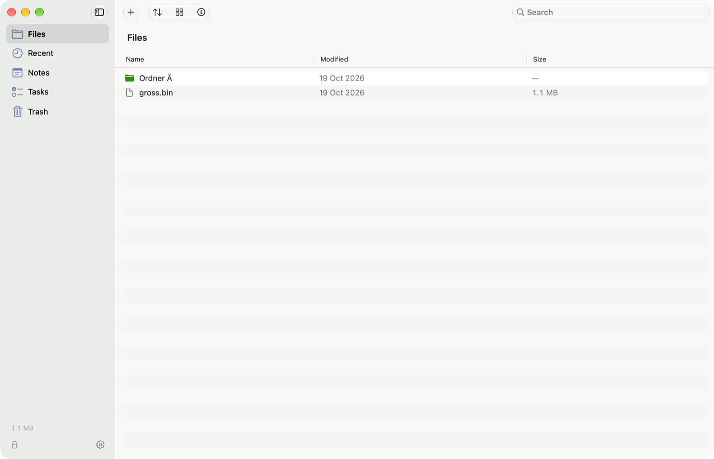
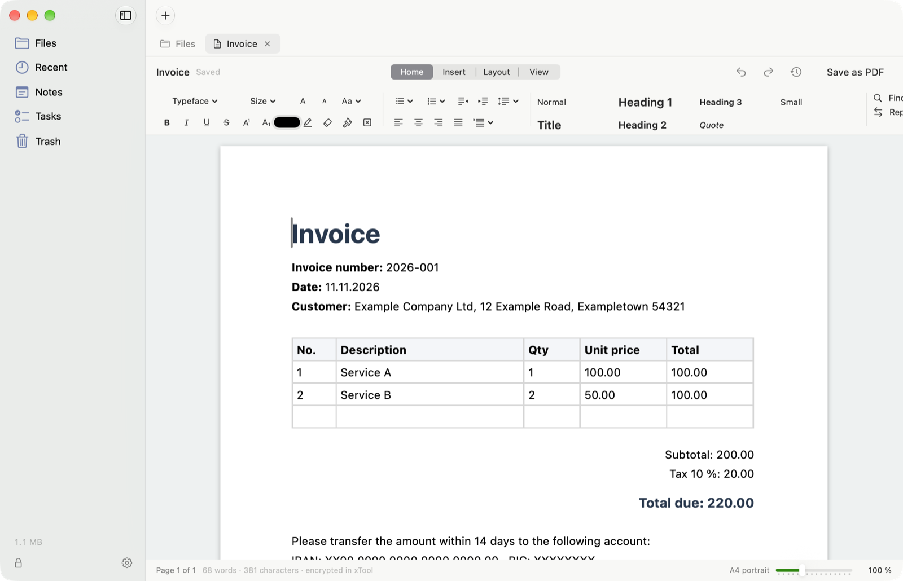

# xTool

A private, encrypted vault for your Mac: files, documents, notes and tasks. Everything stays on your MacBook.
xTool has no network access at all.

- **AES-256-GCM** for everything in the vault, the key derived from your password with **Argon2id** (1 GB of memory per guess)
- **Metadata removal** on export: photos lose their GPS position and camera data, documents lose author names
- **No cloud, no account, no telemetry**, open source under the MIT license

<p align="center">
  
  
</p>

> **Before you rely on xTool for sensitive work, read the [threat model](docs/THREAT_MODEL.md).**
> It explains what xTool protects against, and what it cannot protect against (for example spyware on your Mac).
> xTool has not been independently audited.

## Install

1. Build the app (see [Build it yourself](#build-it-yourself)). This creates `dist/xTool-2.2.0.dmg`.
   Every push to `main` also builds a DMG on GitHub (Actions → macOS build → Artifacts).
2. Open the DMG and drag **xTool** into the Applications folder. An existing vault is kept.

xTool is not notarized by Apple. On first launch macOS will warn you: open **System Settings → Privacy & Security** and choose **Open Anyway**.

## Using xTool

| What | How |
|---|---|
| Add files | Drag them into the window, `+`, or ⌘O |
| Get files out | Select → **Export** or ⇧⌘E |
| Get everything out | Settings → All files → Export |
| Lock | Lock icon at the bottom left or ⌃⌘L. Also happens when you close the lid. |
| Switch sections | ⌘1 to ⌘5, Settings ⌘, |
| Tabs | ⌘W closes, ⇧⌘] and ⇧⌘[ switch |
| Focus mode | ⌃⌘F |

### Documents

The Writer shows real pages, A4 by default (change it under **Layout**). When you write past the end of a page, the text continues on the next one.
Header, footer and page numbers appear on every page, and the status bar shows "Page 2 of 5". A PDF looks exactly like the pages on screen.
Documents are saved as `.docx`, so Word and Pages can open them after export.

### Large files

Only your free disk space limits the file size: xTool encrypts 1 MB at a time. During a transfer the Mac stays awake and the automatic lock pauses.
Closing the lid still locks and cancels the transfer; finished files are kept.

xTool previews files up to these sizes; above them, export the file to open it: text 20 MB, images and Office 256 MB, PDF 1 GB.
Video, audio and archives have no preview.

### Password

New passwords need at least 12 characters and must not be easy to guess. xTool does not just count special characters,
it estimates what an attacker would try: known passwords, words, keyboard rows, repetitions, years.
`Summer2024!` fails, four random words pass. **Suggest Password** creates six random words.

An existing weaker password keeps working; xTool then recommends changing it. **Nobody can reset a forgotten password.**

When you change the password, xTool can also **encrypt everything again with a new key** (on by default), so that old
copies of the vault, for example in a backup, open nothing with the old password. You can also do this on its own:
Settings → Encryption key → Renew. It is safe against crashes and power loss.

### Isolation

- Text stays in xTool: Writing Tools, Services, web search and sharing from macOS are switched off in the editors.
  Spell checking is off and can be turned on in Settings.
- What you copy from xTool is removed from the clipboard after 2 minutes and when the vault locks, and it is not sent to your other devices.
- xTool locks after 1 minute without activity by default, and whenever the Mac sleeps or the screen locks.
- xTool windows are hidden from screenshots, screen recordings and screen sharing.
- xTool warns before every export, because exported files are no longer encrypted.

### Metadata

With **Settings → Remove metadata when exporting** turned on (the default), exported copies are cleaned:

- **Photos** (JPEG, PNG, HEIC, TIFF): GPS position, camera, lens, dates, names, comments
- **PDF**: author, title, keywords, hidden XMP data, attachments, scripts (the PDF is rebuilt page by page)
- **Word, Excel, PowerPoint**: author, last editor, company, names on comments and tracked changes

The files inside the vault keep their originals, because for journalists the original metadata can be evidence.
Videos and other types are exported unchanged. Details: [threat model → Metadata](docs/THREAT_MODEL.md#metadata).

### Backup

Settings → Backup creates an `.xvault` file. It stays encrypted and needs the password that was in use when it was created.
When restoring, xTool first checks the password and the content, then replaces the vault; the old one is kept next to it.
On a new Mac you can restore directly from the start screen.

## Security

- **Encryption:** AES-256-GCM for everything in the vault: files, documents, notes, tasks and the index with all file names.
  Every file has its own key, and any change to the encrypted data is detected when it is opened.
- **Password:** The key is derived from your password with Argon2id (1 GB of memory and 3 passes per guess). That makes every single guess expensive.
- **Isolated:** No network access (enforced by the macOS App Sandbox), no cloud, no telemetry.
- **Standard building blocks:** libsodium and Apple CryptoKit. No home-made cryptography.

xTool's security rests on your password alone, not on secret code. That is why the code can be public: anyone can check how
the encryption works ([docs/FORMAT.md](docs/FORMAT.md)) and what it protects against ([docs/THREAT_MODEL.md](docs/THREAT_MODEL.md)).
The test vaults in `Tests/Fixtures/` contain only made-up sample data; their password is in the tests on purpose.

Found a vulnerability? See [SECURITY.md](SECURITY.md).

## Longevity

xTool needs no updates to keep working: no server, no account, no license, no expiry date. It runs on macOS 14 and later, on Apple Silicon and Intel.

There can be no guarantee for every future macOS version, that is Apple's decision. So your data does not depend on the app:

- **Export:** You can take everything out unencrypted at any time.
- **Open format:** [docs/FORMAT.md](docs/FORMAT.md) describes the vault completely; it could be decrypted without xTool.
- **Rebuild:** All dependencies are in `Vendor/`, the build needs no internet.

Make regular backups to another drive. They also protect you against a broken MacBook.

## Build it yourself

You need the Xcode Command Line Tools (`xcode-select --install`).

```bash
bash Scripts/build_app.sh
```

```bash
bash Scripts/run_tests.sh
```

How the code is organized: [docs/ARCHITECTURE.md](docs/ARCHITECTURE.md).

## License

xTool is open source under the [MIT License](LICENSE): you may use, change and share the code freely, also commercially, as long as the license notice is kept.

The logo is excluded; all rights to it are reserved (see [NOTICE](NOTICE)). The libraries in `Vendor/` keep their own licenses:
libsodium and swift-sodium (ISC), ZIPFoundation (MIT).
